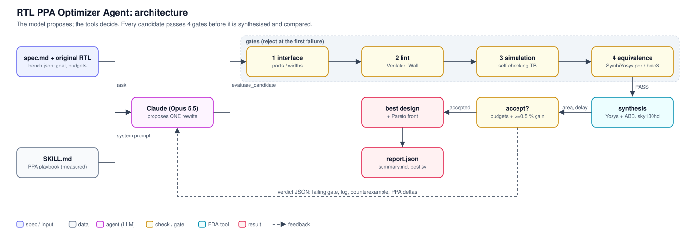
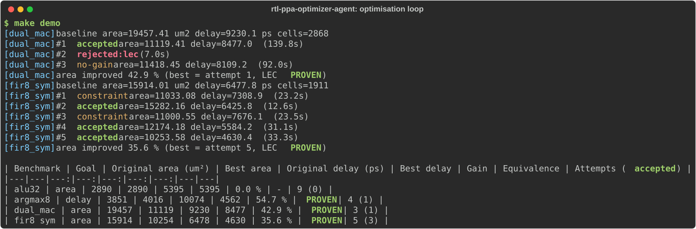
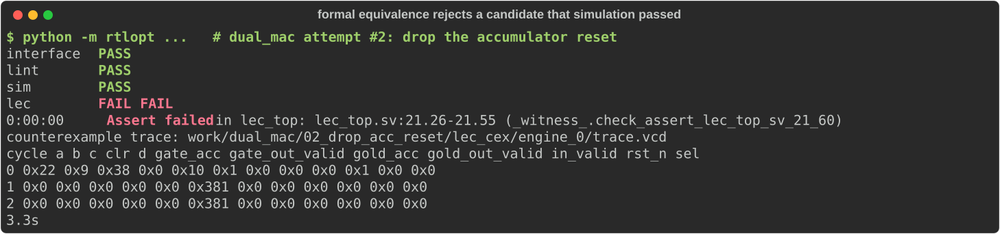
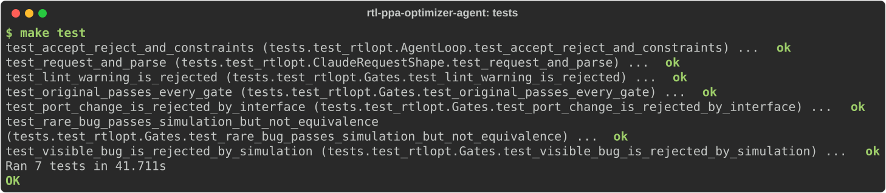

# RTL PPA Optimizer Agent

[](https://github.com/Ana2601/rtl-ppa-optimizer-agent/actions/workflows/ci.yml)

An LLM agent that takes an existing RTL module and its spec and rewrites it for lower
area or delay. It keeps going until it runs out of ideas. **The tools, not the model,
decide what counts as better:** every candidate must pass the interface check,
Verilator lint, simulation and a formal equivalence check against the original before
it is synthesised (Yosys + ABC on SkyWater sky130_fd_sc_hd) and compared with the best
design so far.



## Results

Recorded trajectories, replayed by CI. Each verdict is recomputed by the tools on every run
(full log: [`results/summary.md`](results/summary.md)).

| Benchmark | Goal (constraint) | Original | Best | Gain | Equivalence of best | Attempts (accepted) |
|---|---|---|---|---:|---|---|
| `dual_mac` | area (delay ≤ 1.10×) | 19,457 um² · 9,230 ps | 11,119 um² · 8,477 ps | **−42.9 % area** | proven (unbounded) | 3 (1) |
| `argmax8` | delay (area ≤ 1.20×) | 3,851 um² · 10,074 ps | 4,016 um² · 4,562 ps | **−54.7 % delay** | proven (unbounded) | 4 (1) |
| `fir8_sym` | area (delay ≤ 1.10×) | 15,914 um² · 6,478 ps | 10,254 um² · 4,630 ps | **−35.6 % area**, −28.5 % delay | proven (unbounded) | 5 (3) |
| `alu32` | area (delay ≤ 1.05×) | 2,890 um² · 5,395 ps | unchanged | **0 %** | (original) | 9 (0) |



What the agent found, and what the gates stopped:

- **dual_mac.** Muxing the operands instead of two products shares one 16×16
  multiplier (−43 %). Yosys's `share` pass does not do this. It then tried dropping
  the accumulator's reset. **Simulation passed** (Verilator zero-initialises
  registers), but **the equivalence check rejected it** and returned this trace:

  ```
  cycle a    b   c    clr d    gate_acc gold_acc in_valid rst_n sel
      0 0x22 0x9 0x38 0x0 0x10 0x1      0x0      0x1      0x0   0x0
      1 0x0  0x0 0x0  0x0 0x0  0x381    0x0      0x0      0x0   0x0
  ```

  The un-reset accumulator powers up with garbage that the spec says must be 0.

  
- **argmax8.** A tournament tree cuts the delay by 55 % at +4 % area. The all-pairs and
  hybrid structures are faster still (−61 % to −70 %), but they need 1.24× to 2× the
  area. The spec allows 1.2×, so they are reported as Pareto points, not accepted.
- **fir8_sym.** Three transforms stack:
  - datapath registers lose their reset (allowed: `y` is don't-care until the fill
    counter, which keeps its reset, raises `out_valid`);
  - the symmetric taps are folded, with the pre-adders **retimed into registers**
    so they leave the critical path;
  - constant multiplies become CSD shift-adds.

  The first folding attempt broke the delay budget. A balanced adder tree did nothing,
  because Yosys rebuilds the sum itself. Retiming fixed it.
- **alu32: a real negative result.** Yosys already shares the subtractor with the
  comparators, and equality with the XOR. Every shared-adder design saves 9–17 % area
  but costs 18–58 % delay, even as a carry-select adder. That is outside the 5 % budget,
  so the original stands, and the report lists the Pareto front.

## How it works

| Path | What it does |
|---|---|
| [`rtlopt/tools.py`](rtlopt/tools.py) | The gates and the metric. It generates the LEC miter and runs SymbiYosys/ABC, parses counterexample VCDs into a cycle table, and synthesises with the vendored sky130 liberty |
| [`rtlopt/agent.py`](rtlopt/agent.py) | The loop: tool schemas (`evaluate_candidate`, `get_best`, `finish`), accept/reject policy, constraint checks, Pareto front, report |
| [`rtlopt/llm.py`](rtlopt/llm.py) | `ClaudeBackend` (Anthropic SDK, tool use, records every turn) and `ReplayBackend` (replays a recorded trajectory) |
| [`skills/rtl-ppa-optimization/SKILL.md`](skills/rtl-ppa-optimization/SKILL.md) | The agent's skill: which rewrites pay off with Yosys/ABC on sky130 and which don't, with measured numbers, correctness traps, and how to read each gate's feedback. It is loaded into the system prompt |
| [`benchmarks/*/`](benchmarks) | Each benchmark has `spec.md` (what must be preserved, what is don't-care), the original RTL, a self-checking testbench, and `bench.json` (objective, constraints, LEC settings) |
| [`trajectories/*/`](trajectories) | Recorded proposals (`trajectory.json` plus one `.sv` per candidate) |

### The equivalence gate

The check builds `lec_top`, which drives the original and the candidate with the same
inputs and asserts that their outputs match:

- **Power-up values are free**, as on silicon. Reset is held in cycle 0, and outputs are
  compared from cycle 1 on. So removing a reset only passes if the register's power-up
  value can never reach a compared output.
- **Don't-care outputs.** An output with a qualifier (`"lec_compare": {"y": "out_valid"}`)
  is only compared while the qualifier is high in the original. This is how the spec
  says "data is don't-care while valid is low".
- **Engines.** Combinational designs use ABC `dprove` (CEC). Sequential designs use
  ABC `pdr`, an unbounded proof. When the proof doesn't finish in its time box, the
  check falls back to a bounded `bmc3` run from reset, and the result says how many
  cycles were covered (`BOUNDED(k)`). A depth below the design's latency counts as
  inconclusive and is rejected.
- **Reduced widths.** Arithmetic is checked at reduced parameter widths (for example
  `W=6`), which keeps SAT on multipliers and reassociated adder trees tractable. This
  is a standard trade-off, and the reason candidates must stay parametric.

### The tests

`make test` checks that each gate rejects the bug it exists for:

| Mutant | Rejected by |
|---|---|
| widened output port | interface |
| dead signal left behind (functionally identical) | lint |
| SLT computed unsigned | simulation |
| ADD wrong only when `a == 0xDEADBEEF` (random simulation never hits it) | **equivalence only** |

It also runs the agent loop with a scripted model, and the Claude backend against a
stub client to check the request fields.



## Run it

Setup: [OSS CAD Suite](https://github.com/YosysHQ/oss-cad-suite-build), or
Yosys ≥ 0.40, Verilator ≥ 5.020 and SymbiYosys, plus Python 3.10+.

```bash
make test                  # gates + mutants + agent loop (~1 min)
make demo                  # replay all trajectories, write results/summary.md (~6 min)
make check                 # headline gains still reproduced
```

Live, with Claude. The agent uses `claude-opus-5-5` with tool use and server-side
refusal fallback enabled:

```bash
pip install -r requirements.txt
export ANTHROPIC_API_KEY=...
make live BENCH=fir8_sym   # writes results_live/<bench>/ including a new trajectory/
```

A live run records its own trajectory, so it can be replayed later without a key.

## Honest notes

- **Where the trajectories come from.** They were produced interactively during
  development: Claude proposed each candidate after reading the previous verdict from
  these tools. CI replays the *proposals*; it does not replay the verdicts. Live runs
  call the API. Nothing in the replayed results comes from the model's own judgement
  of quality.
- **Delay is ABC's static timing of the mapped logic** (the worst register-to-register
  or I/O path, sky130 typical corner, no wire load). That is a good relative metric
  for comparing RTL variants, but it is not sign-off STA. The RTL-to-GDS agent team
  project runs OpenROAD and OpenSTA for that.
- **The benchmarks shaped the skill.** The skill file was refined from these
  experiments: for example, the CSD finding contradicted my first draft. A fair
  evaluation of the live agent should use designs it has not seen.

## Related work

RTLRewriter (ICCAD 2024), [CRADLE](https://arxiv.org/html/2508.08709v1),
[SymRTLO](https://arxiv.org/pdf/2504.10369v2), [RTLScout](https://arxiv.org/html/2606.06530)
and [MCP4EDA](https://www.arxiv.org/pdf/2507.19570) all use Yosys- or OpenROAD-in-the-loop
optimisation. This project's emphasis is the **formal equivalence gate with spec-level
don't-cares**. Most LLM optimisation loops only check simulation, and as
`dual_mac` #2 shows, simulation alone accepts a broken design.

Part of a hardware portfolio. See also
[uvm-testbench-generator-agent](https://github.com/Ana2601/uvm-testbench-generator-agent) and
[rtl2gds-agent-team](https://github.com/Ana2601/rtl2gds-agent-team).
